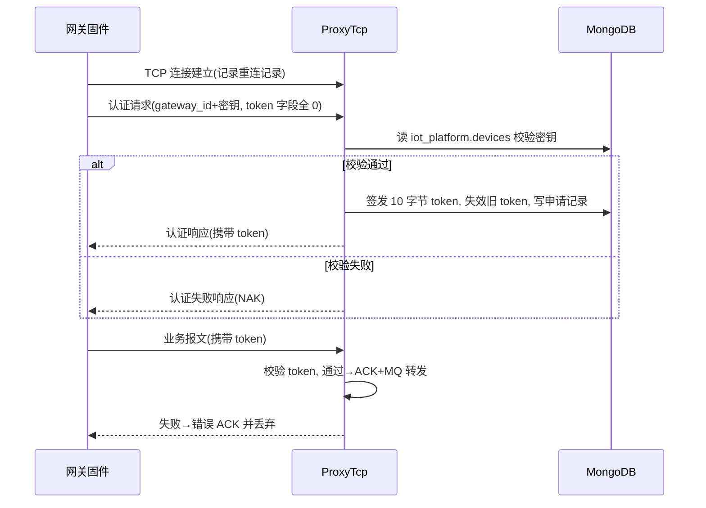

## 产品概述

为 IoT 平台新增“网关认证”机制：网关首次联网时使用 gateway_id + 预共享密钥向平台发起认证，平台校验该网关已入库后签发 10 字节 token；此后网关发送和接收的所有报文都在传输层携带该 token，由 ProxyTcp 模块统一验证；每次重连必须重新申请新 token（旧 token 立即失效）；ProxyTcp 记录重连记录和 token 申请记录，并在 web 管理端提供查询。

## 核心功能

- **认证协议**：新增网关认证请求/响应命令字；认证通过前（token 缺失/无效/未认证）的业务报文一律回错误 ACK、丢弃、不向 MQ 转发，并记日志
- **token**：10 字节二进制随机数，嵌入传输层定长段（41→51 字节），protocolVersion 同步升级，不需兼容未升级固件的旧网关
- **认证凭据**：gateway_id + 预共享密钥；platform_java 的 Device 增加密钥字段，入库接口支持录入
- **token 校验**：在 ProxyTcp 解码后、业务分发前校验上下行报文 token，无效即 NAK + 丢弃 + 记录
- **记录**：重连记录（deviceId、IP、连接/断开时间、首次/重连类型）与 token 申请记录（时间、结果、IP）写入 ProxyTcp 的 Mongo，并提供 REST 查询接口
- **web_vue3**：网关入库表单增加密钥输入；新增重连记录 / token 申请记录查询页面
- **网关固件**：TCP 连接成功后发起认证申请、内存保存 token、全部上行/ACK/重发报文统一填 token、断线重连后重新申请

## 技术栈

- 后端：Java 8/11 + Spring Boot（ProxyTcp、platform_java），Netty TCP 服务，Spring Data Mongo（ProxyTcp 双实现 Mongo/H2 沿用现有模式）
- 协议：沿用 0xFFEE 外层帧 + 传输层定长段 + serviceData 的三层结构；认证消息在 ProxyTcp 终结，不进入 dtm/MQ（避免 dtm “ServiceType↔Encoder↔schema 三者一致性”约束产生死代码）
- 固件：RT-Thread + C（Gateway4GCat1），token 存内存（每次重连重新申请，无需 flash 持久化）
- 前端：web_vue3（Vue3 + TypeScript + Element Plus，沿用现有管理端风格）

## 认证时序



## 传输层定长段扩展（核心契约）

- 现有 41 字节：deviceId(11)+nodeId(11)+时间(6)+messageId(4)+serviceType(1)+serviceVersion(1)+encoding(1)+protocolVersion(1)+encryption(1)+eventId(4)
- 扩展为 51 字节：在 eventId 后追加 token(10)；`protocolVersion` 由 1 升为 2；ProxyTcp 下行报文由 ProxyTcp 填充当前有效 token，网关侧校验
- 命令字：新增认证请求/响应两个 serviceType（取未用值，固件与 ProxyTcp 常量保持一致），认证响应 serviceData 含 10 字节 token + 结果码

## 关键实现点

- **ProxyTcp 跨库读取**：认证需读 platform_java 的 `iot_platform.devices` 集合（校验 secret），在 ProxyTcp 增加指向 iot_platform 库的只读 MongoTemplate 配置；token/记录写入自身 `proxy` 库，仿 `persistence/` 现有 Mongo/H2 双实现模式
- **校验点**：`TransportUplinkProcessor.process()` 解码+CRC 之后、bindDevice/MQ 转发之前；认证请求命令字直接在 Processor 内终结
- **重连挂点**：`UplinkChannelHandler.channelActive/Inactive` + `ChannelRegistry.bindDevice` 换绑时判定首次/重连
- **固件**：`connect_callback` 触发认证服务，认证成功才放行时间同步等后续服务；token 由 `cloud_uplink_process`/ACK/重发路径统一填充；`transport_mem_pool_manager` 按新结构体大小重建内存池

## 目录结构

```
iot-platform/
├── docs/protocol-gateway-auth.md                          # [NEW] 认证协议与定长段文档
├── ProxyTcp/src/main/java/com/proxy/
│   ├── model/CommonTransportMessage.java                  # [MODIFY] 41→51 字节，token 字段
│   ├── codec/v2/TransportcoderByteImplV2.java             # [MODIFY] token 编解码
│   ├── transport/TransportUplinkProcessor.java            # [MODIFY] 认证校验点、NAK、记录挂接
│   ├── transport/TransportDownlinkProcessor.java          # [MODIFY] 下行填充当前 token
│   ├── netty/UplinkChannelHandler.java                    # [MODIFY] 连接/断开记录
│   ├── auth/GatewayAuthService.java                       # [NEW] 密钥校验、token 签发/验证/失效
│   ├── auth/GatewayAuthConstants.java                     # [NEW] 认证命令字与结果码常量
│   ├── model/GatewayReconnectRecord.java                  # [NEW] 重连记录文档
│   ├── model/GatewayTokenRequestRecord.java               # [NEW] token 申请记录文档
│   ├── persistence/*(Mongo/H2 Service+Repository)         # [NEW] 三类集合持久化(仿现有双实现)
│   └── web/GatewayRecordController.java                   # [NEW] 记录查询 REST API
├── ProxyTcp/src/main/resources/application.yml            # [MODIFY] 跨库 Mongo、API 配置
├── platform_java/src/main/java/com/iot/platform/
│   ├── model/Device.java                                  # [MODIFY] 增加 authSecret 字段
│   └── service/DeviceService.java + controller/DeviceController.java  # [MODIFY] 密钥录入/更新(返回掩码)
├── Gateway4GCat1/
│   ├── transport_udp/transport_udp_message.h              # [MODIFY] 定长 51、token 字段、认证命令字
│   ├── transport_udp_encoder/transport_udp_encoder.c      # [MODIFY] token 编解码与长度校验
│   ├── transport_udp/transport_udp_handler.c              # [MODIFY] 上行/ACK/重发填 token、下行校验
│   ├── service_udp/service_gateway_auth.c/.h              # [NEW] 认证服务(申请/重试/保存 token)
│   ├── service_manager/service_manager_udp.c              # [MODIFY] 注册认证服务
│   ├── transport/transport_mem_pool_manager.c             # [MODIFY] 内存池按 51 字节调整
│   └── applications/main.c                                # [MODIFY] 连接成功后触发认证
└── web_vue3/src/
    ├── api/gatewayRecords.ts                              # [NEW] 记录查询 API
    ├── api/devices.ts                                     # [MODIFY] 密钥字段
    ├── views/gateway/records.vue                          # [NEW] 记录查询页面(Tab: 重连/token 申请)
    ├── views/devices/…                                    # [MODIFY] 入库表单增加密钥输入
    ├── router/routes.ts                                   # [MODIFY] 新路由
    └── vite.config.ts                                     # [MODIFY] /proxy-api 代理
```

## 设计风格

沿用 web_vue3 现有 Element Plus 管理端风格，不引入新设计体系。新增“网关记录”页面：顶部筛选栏（设备 ID、时间范围、结果状态）+ Tab 切换“重连记录 / token 申请记录”+ Element Plus Table 分页列表；状态用 tag 颜色区分成功/失败。网关入库表单在现有对话框中增加“预共享密钥”输入项（password 类型带显隐切换），编辑时掩码显示。

## Agent Extensions

### Skill

- **Git**
- Purpose：全链路实现完成后按规范提交代码到 iot-platform 单一权威仓库
- Expected outcome：改动按逻辑分组提交并推送到 origin/main